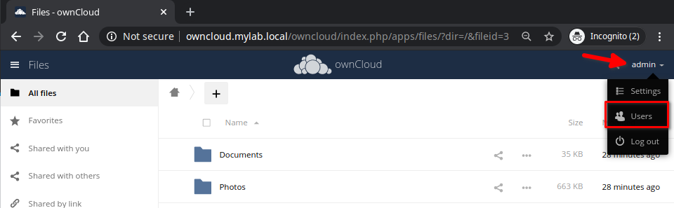
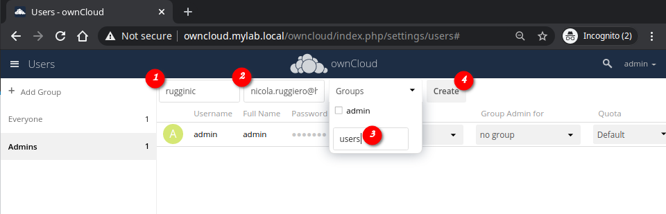
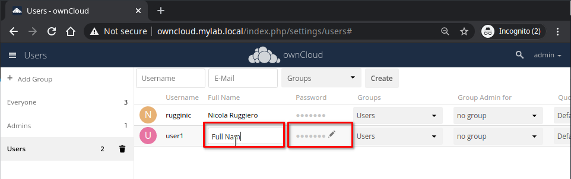

# Adding Users
1. Login to the web interface with your **Admin** credentials;
2. On the top right corner, select **admin** and chose **Users**

3. Add the user's details

4. Once created, from this pane you can set a temporary **password** for the user and change its full name or leave it for him/her to complete.

## Related
- [ownCloud Tutorial Part 1: Install and Configure the Server]()
- [ownCloud Tutorial Part 2: Configure custom URL and HTTP port]()
- [ownCloud Tutorial Part 3: Adding new Users]()
- [ownCloud Tutorial Part 4: Configure Desktop and Mobile Clients]()