## Prerequisites
  * **VMware Workstation Player** (free): https://www.vmware.com/products/workstation-player/workstation-player-evaluation.html
  * **VMware VIX 1.17.0 API** for Windows 64-bit operating systems: https://www.dropbox.com/s/ffhqh17kaxjgk8k/VMware-VIX-1.17.0-6661328.exe?dl=0
  * **GNS3**: https://www.gns3.com/software/download
  * CISCO IOS **Router image** (c3725-adventerprisek9-mz.124-17.bin) : https://www.dropbox.com/sh/9owd781pm2akic8/AACR6W0GE8gHX-36JYl6fMa4a?dl=0

 > For **VMware Workstation Pro**, the VIX API is not needed, so if you either have the **Pro** version already installed, or plan to install the 30 days trial, or decide to buy the **Pro** version, you can skip VMware VIX API installation and "hack".

 > If you have an old version (<=14.x) of **VMware Workstation Player** installed, you most likely don't need to hack the VIX API, so you can skip that part.

## Installation
1. Install VMware Workstation Player (VMware-player-15.5.2-15785246.exe)
2. Install VMware VIX 1.17.0 API (VMware-VIX-1.17.0-6661328.exe)
3. Install GNS3 (GNS3-2.2.7-all-in-one-regular.exe)
   1. On **Choose Components** select **GNS3 Desktop** and **GNS3 VM**\
   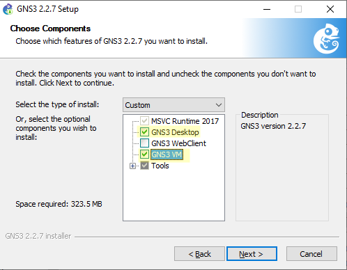
   2. On **GNS3 VM**, select **VMware Workstation**\
   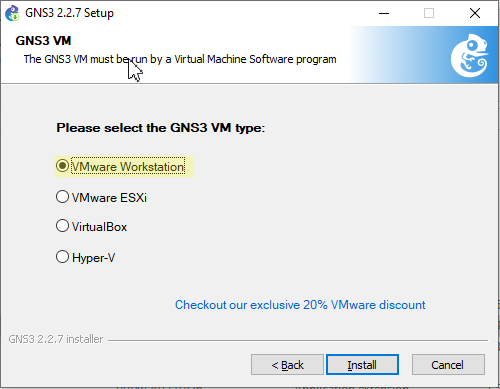
   3. Click **Finish** and unselect **start GNS3**\
   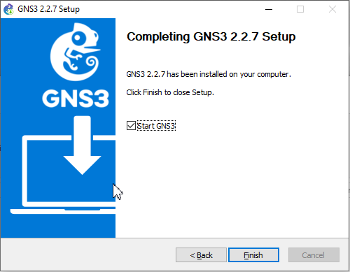

## VIX API Hack
The latest available version of VIX API 1.17.0 was released in 2017 and is not compatible with VMware Workstation Player 15.x.
Don't worry, in order to get it working, we will have to hack some configuration files.
1. Open **`vixwrapper-config.txt`** in **`C:\Program Files (x86)\VMware\VMware VIX`**. (Take a copy of the file before making any changes)
 
```bash
#@Version-Info
#
# VixAllProducts revision mapping
#
# This file translates product version specifications into the appropriate Vix
# implementations.
#
# Each @Version-Info line has 5 white-space seperated entries:
#
#    provider-type: ws, esx, viserver, etc
#    apiVersion: the apiVersion supported, as passed in from VixHost_Connect()
#    ipc-type: none, vmdb, vmodl, cim
#    product-version: the product version string
#
#    implementation-directory: the path to the library that implements the
#          version described by the first 4 parameters
#
#
# The configuration is based on the first 4 fields, which describe
# the product.  The 5th field is the location.  To force it to try
# multiple location, the same configuration can be repeated.  Note that
# list is built in LIFO order, so the latest entry in the configuration
# will be the first used.  If for some reason that value fails, it will
# continue through any other matches.

# Workstation 14.0.0
ws        19  vmdb  14.0.0 Workstation-14.0.0
player    19  vmdb  14.0.0 Workstation-14.0.0

# latest un-versioned
ws        19  vmdb  e.x.p Workstation-14.0.0
player    19  vmdb  e.x.p Workstation-14.0.0

# EOF
 
```

2. Add the following lines before **`# latest un-versioned`**  
```bash
# Workstation and Player 15.5.2
ws        19  vmdb  15.5.2 Workstation-15.0.0
player    19  vmdb  15.5.2 Workstation-15.0.0
ws        19  vmdb   e.x.p Workstation-15.0.0
player    19  vmdb   e.x.p Workstation-15.0.0
 
```

Here is what the file looks like after making the changes:
```bash
#@Version-Info
#
# VixAllProducts revision mapping
#
# This file translates product version specifications into the appropriate Vix
# implementations.
#
# Each @Version-Info line has 5 white-space seperated entries:
#
#    provider-type: ws, esx, viserver, etc
#    apiVersion: the apiVersion supported, as passed in from VixHost_Connect()
#    ipc-type: none, vmdb, vmodl, cim
#    product-version: the product version string
#
#    implementation-directory: the path to the library that implements the
#          version described by the first 4 parameters
#
#
# The configuration is based on the first 4 fields, which describe
# the product.  The 5th field is the location.  To force it to try
# multiple location, the same configuration can be repeated.  Note that
# list is built in LIFO order, so the latest entry in the configuration
# will be the first used.  If for some reason that value fails, it will
# continue through any other matches.

# Workstation 14.0.0
ws        19  vmdb  14.0.0 Workstation-14.0.0
player    19  vmdb  14.0.0 Workstation-14.0.0

# Workstation and Player 15.5.2
ws        19  vmdb  15.5.2 Workstation-15.0.0
player    19  vmdb  15.5.2 Workstation-15.0.0
ws        19  vmdb   e.x.p Workstation-15.0.0
player    19  vmdb   e.x.p Workstation-15.0.0

# latest un-versioned
ws        19  vmdb  e.x.p Workstation-14.0.0
player    19  vmdb  e.x.p Workstation-14.0.0

# EOF
 
```

3. Save and Close the file. Notepad++ will ask for "Administrator mode"
4. Go back to the folder **`C:\Program Files (x86)\VMware\VMware VIX`**
5. Make a copy of the folder **`Workstation-14.0.0`** and rename **`Workstation-15.0.0`**. Here is the result:
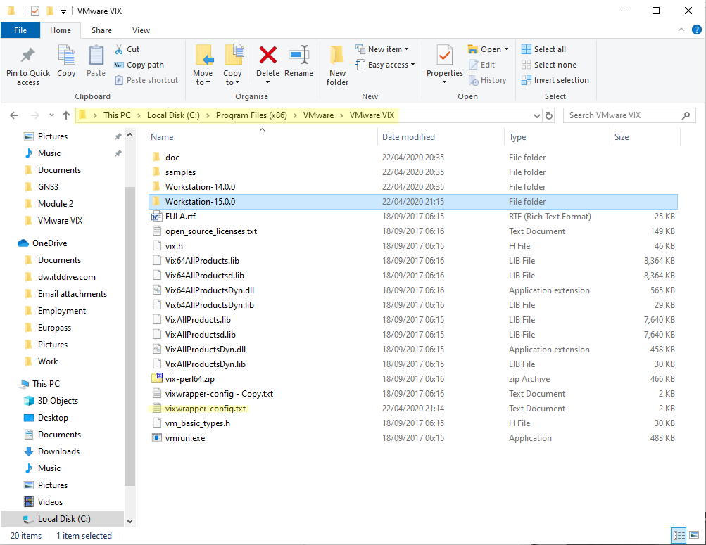


## Initial Configuration
1. Import **GNS3 VM** into **VMware workstation Player**
   1. Unzip the VM image (*GNS3.VM.VMware.Workstation.2.2.7.zip in your user's Downloads folder*)
   2. Doubleclick **GNS3 VM.ova** to import the VM\
   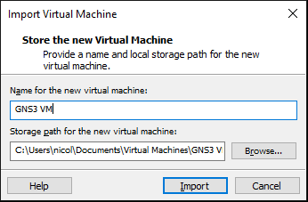
   3. Choose **Import**\
   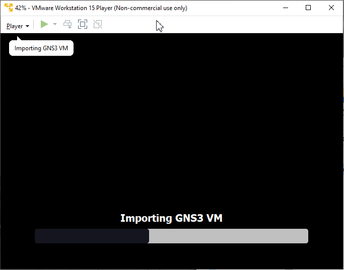
   4. If you get this error:\
   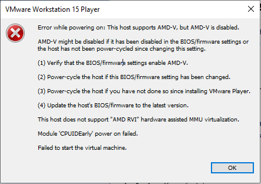
   it means that Virtualization Support is disabled in you Laptop / PC. It must be enabled in the BIOS or UEFI. Please refer to your vendor's documentation on how to enable it.

If the **GNS3 VM** is configured correctly you should see the VM running on **VMware Workstation** every time you open GNS3 and you should also see 2 servers in the Server Summary screen:
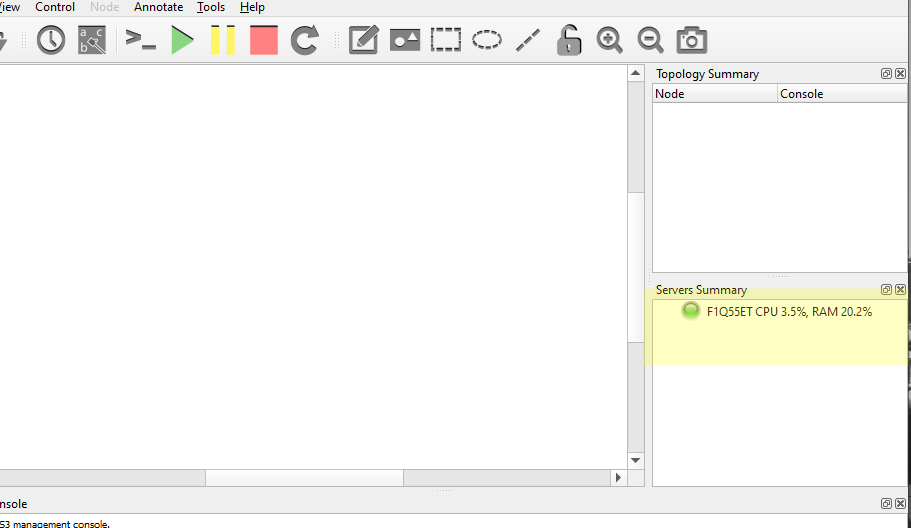

To configure the GNS3 VM, click on **Edit** > **Preferences** > **GNS3 VM**\
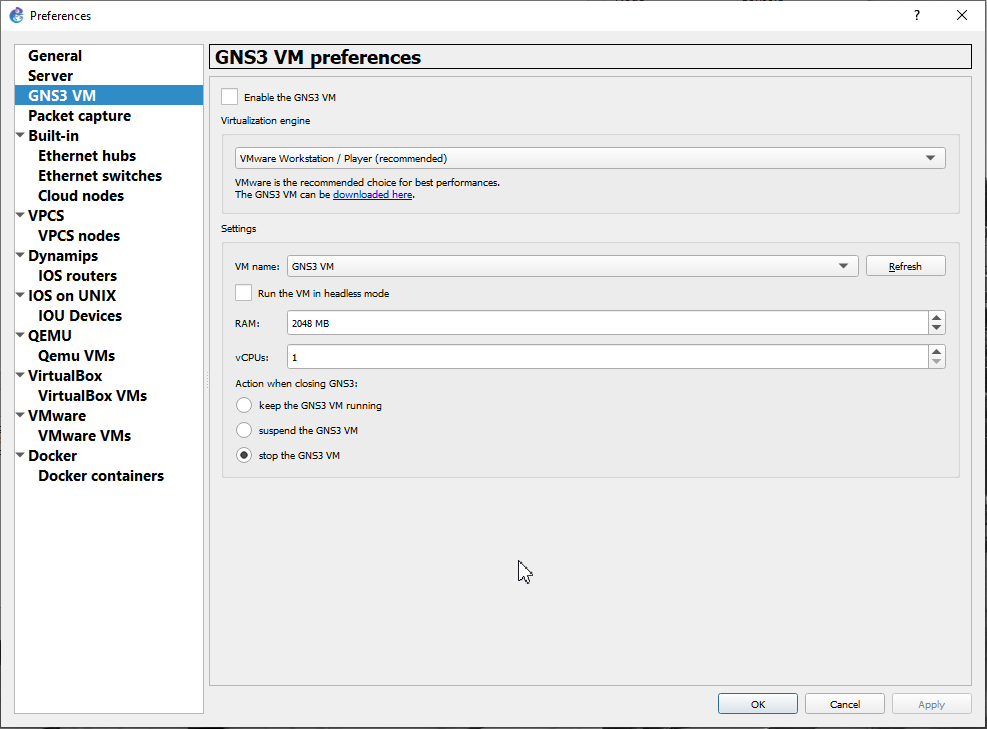
  * Select **Enable the GNS3 VM** and click **OK**
  * Now the GNS3 VM should start and you should see 2 active servers\
  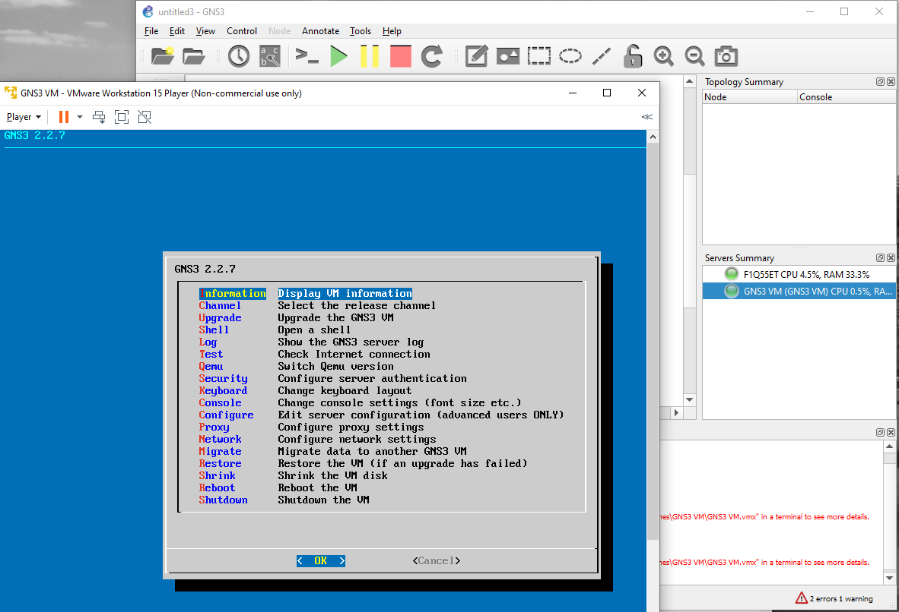

### Importing the router image

#### Method 1
Proceed as follows:
  * **Edit** > **Preferences**
  * Select **Dynamips** > **IOS routers** > **New**
  * **Run this IOS router on the GNS3 VM**
  * **New Image**. Browse for the image
  * Answer **Yes** to decompress the image.
  * Click **Next** repeatedly until **WIC modules** and choose **WIC-2T** for the **`wic 0`**
  * Click **Next** and **Idle-PC finder**
  * Accept the value clicking **OK**
  * Click **Finish**

#### Method 2
Proceed as follows:
  * On the left bar select the router icon and click on the plus sign **New template**
  * Choose the first option **Install an appliance from the GNS3 server (recommended)**
  * Expand Routers, select **Cisco 3725** and click **Install**
  * Choose the default option **Install the appliance on the GNS3 VM (recommended)** and click **Next**
  * The listed version is **124-25.T14** but our image is **124-17** so let's create a new version for our router 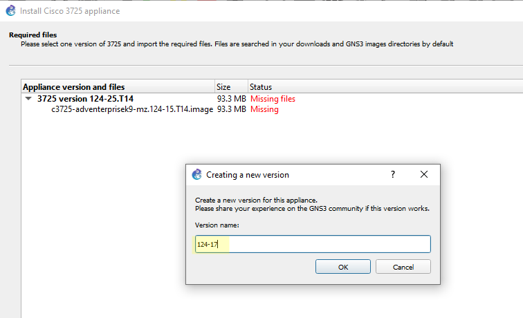
  * Select the last line and click **Import** 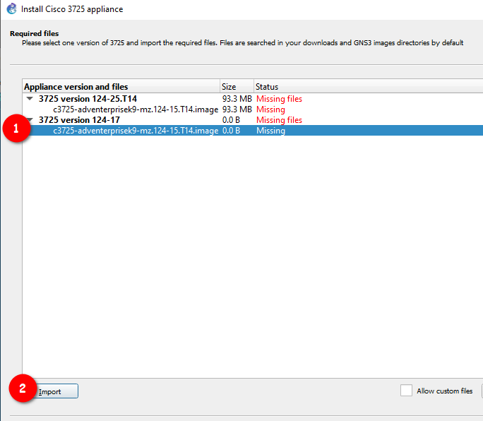
  * Browse for the file donwloaded **`c3725-adventerprisek9-mz.124-17.bin`** 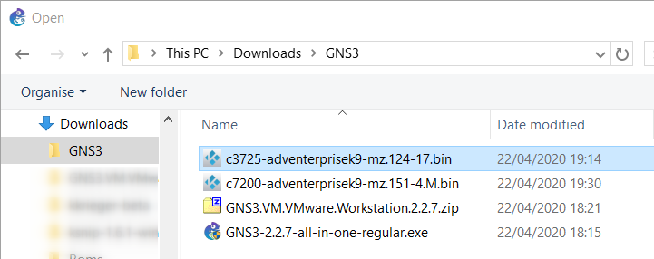
  * The file should be imported and **Ready to install** 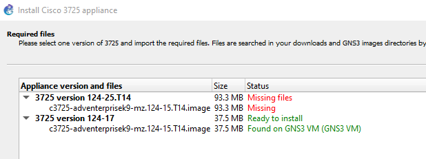
  * Install the new image 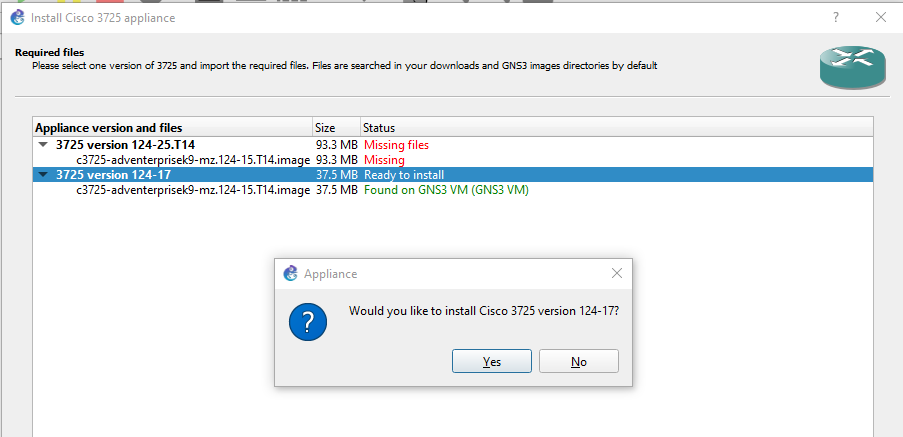
  * In order to add the serial interfaces, right click the router icon and select **Configure template**.
  * Go to **Slots** and choose **WIC-2T** for the **wic 0** slot  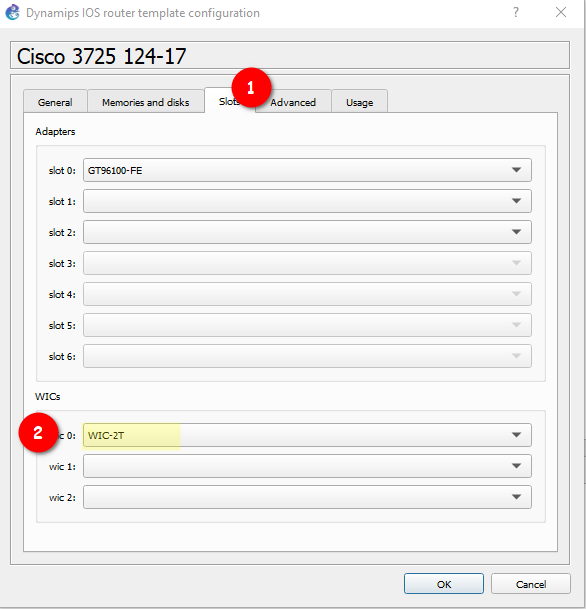

***You are good to go!***
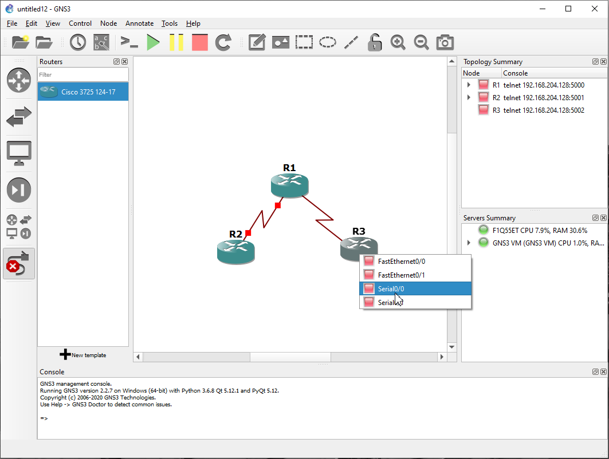\
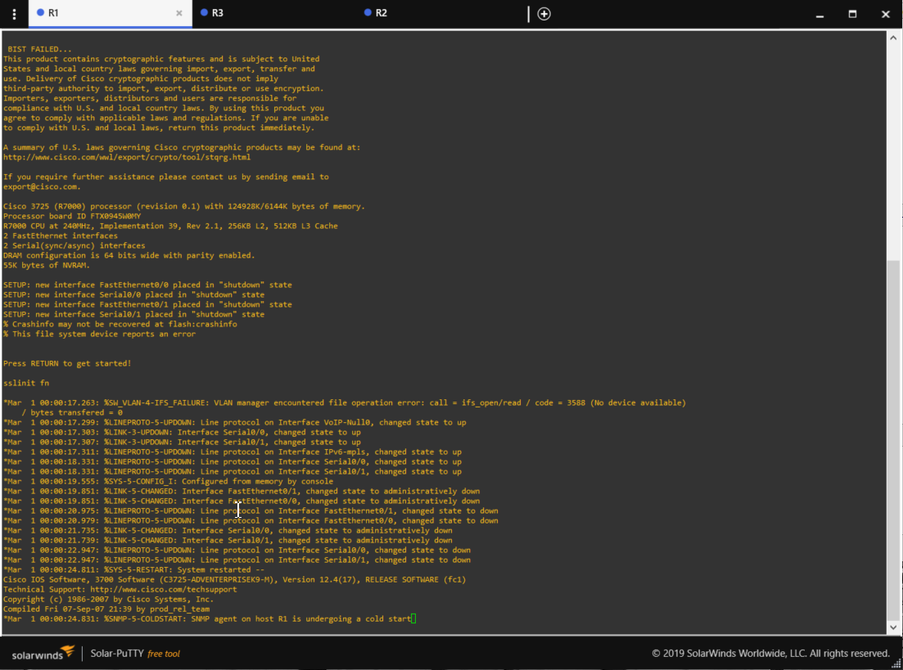