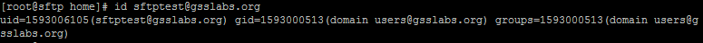

In this article we discuss how to integrate CentOS 7.x & RHEL 7.x with AD (**Windows Server 2008 R2 & Windows Server 2012 R2**).

The following steps are applicable either if you have **CentOS 7** or **RHEL 7**.

**Step 1** - Install the required packages using yum command
```
yum install sssd realmd oddjob oddjob-mkhomedir adcli samba-common samba-common-tools krb5-workstation openldap-clients policycoreutils-python
```

**Step 2** - Update the `/etc/hosts` file and `/etc/resolv.conf` so that the DNS name or hostname of the AD server gets resolved correctly.

**Step 3** - Join Windows Domain or Integrate with AD using realm command:
```
realm join --user=administrator adserver.example.com
```

Verify whether the server has joined the Windows AD Domain or not:
```
realm list
```


Check and Verify AD users
```
id sftptest@gsslabs.org
```


Enjoy!
