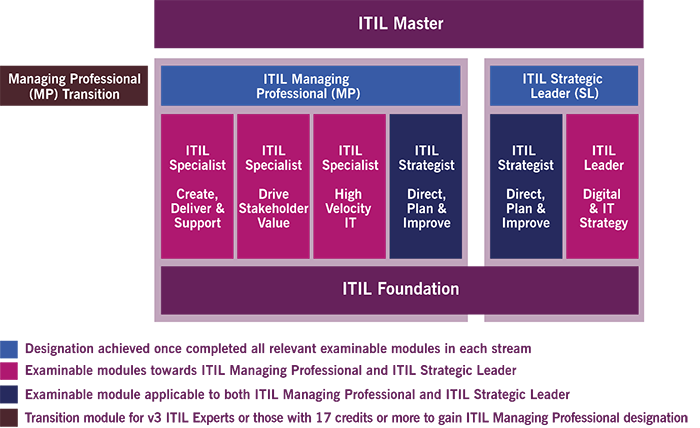
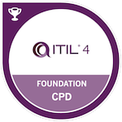

If you work in Technical Support or IT in general, at this time you should already be familiar with the concept of **Best Practices** and [Agile software development](https://en.wikipedia.org/wiki/Agile_software_development).

The **ITIL®** is a set of detailed practices for [IT service management (ITSM)](https://en.wikipedia.org/wiki/IT_service_management) that focuses on aligning IT services with the needs of business.

I decided to take this path and get certified because I believe that nowadays every aspect of most IT related jobs and Companies can be optimised applying the [Guiding Principles](https://www.axelos.com/news/blogs/september-2019/itil-4-transition-no-further-guiding-principles) outlined by **ITIL®**.

ITIL Foundation is the first of 4 levels within the [Certification Scheme](https://www.axelos.com/certifications/itil-certifications.aspx)

The **Foundation Exam** format is:
- Multiple choice examination questions
- 40 questions
- 26 marks required to pass (out of 40 available) - 65%
- 60 minutes duration
- Closed book.

**ITIL 4 Foundation candidates** will have an understanding of the following:
- A holistic approach to the facilitation of co-creation of value with customers and other stakeholders in the form of products and services
- The guiding principles of ITIL 4
- The four dimensions of Service Management
- Key concepts from Lean, Agile, DevOps, and why these are important to deliver business value
- How ITIL practices described in ITIL 4 will maintain the value and importance provided by the current ITIL processes, whilst at the same time expand to be integrated to different areas of service management and IT, from demand to value.

The best resource you can find to prepare for this exam is the official book:
[ITIL® 4 Foundation CPD Official book](https://www.axelos.com/store/book/itil-foundation-itil-4-edition)

You can choose between the paper and the digital version (pdf / ebook). I got mine from Amazon, at this [link](https://amzn.eu/4q5yDpH) and can tell you that it's absolutely worth the money. Not only for preparing the exam but anytime you plan to review processes within your organisation.

## ITIL® 4 Foundation CPD Exam, Brain Dump Questions
1. **Overall, did I find the exam difficult?**\
   _No, I wouldn't say difficult if you study enough._
1. **Was I caught for time?**\
   _No, I think 40 questions in one hour is reasonably fair._
1. **What topics would I advise people to know really well?**\
   _Nothing in particular. Just make sure you understand and remember all the key concepts explained in the **Official Book**._
1. **What topics was I surprised to see?**\
   _Like I said before, nothing in particular._
1. **Test Center or Remote/proctored?**\
   _Remote / Proctored. You can buy and schedule the exam from [PeopleCert](https://www.peoplecert.org/). More information at this [link](https://www.peoplecert.org/browse-certifications/it-governance-and-service-management/ITIL-1/itil-4-foundation-2565)._
1. **Any additional resources to prepare for the Exam?**
   - [ITIL® Foundation 4 First Look](https://www.linkedin.com/learning/itil-foundation-4-first-look) on [LinkedIn Learning](https://www.linkedin.com/learning).
   - [ITIL 4 Foundation Practice Certification Exams](https://www.udemy.com/course/itil-4-foundation-practice-certification-exams-6-exams-q/) on [Udemy](https://www.udemy.com/)

\
[ITIL® 4 Foundation CPD](https://www.youracclaim.com/badges/d64b3a00-177c-4abe-a7ae-98ac91a6781e/public_url)\
Issued by [AXELOS](https://www.youracclaim.com/organizations/axelos/badges)
