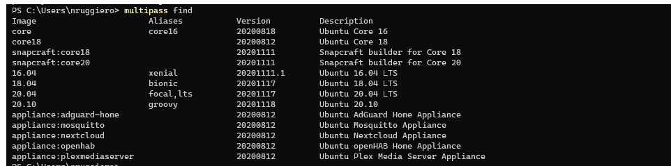
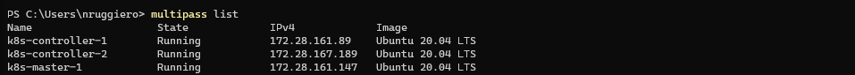
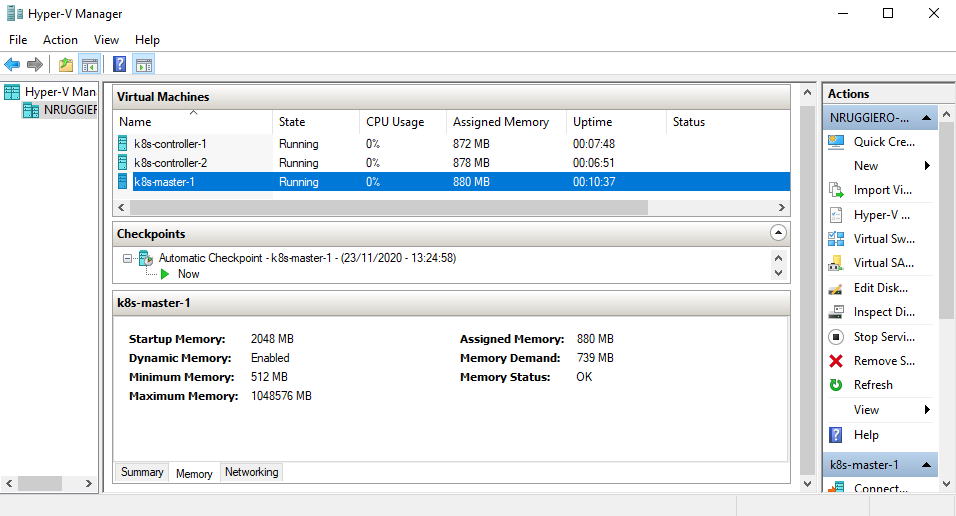
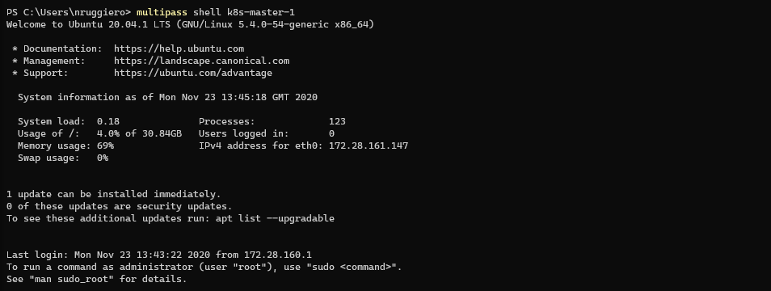

In this short article I will explain how to create a 3 nodes Kubernetes cluster on your Mac leveraging [Ubuntu Multipass](https://multipass.run/).
> "Multipass provides a command line interface to launch, manage and generally fiddle about with instances of Linux. The downloading of a minty-fresh image takes a matter of seconds, and within minutes a VM can be up and running."\
<i>The Register</i>

## Deploy the 3 Kubernetes nodes via Multipass
Let's list what images are available to deploy:
```
multipass find
```


For my Kubernetes Cluster I'll deploy 3 nodes (One master node and two controllers) using `Ubuntu 20.04 LTS` as follows:

- name: **k8s-master-1**
- CPU: 2
- Disk: 32 Gb
- Memory: 2 Gb
- image: 20.04

```
multipass launch -c 2 -d 32G -m 2G -n k8s-master-1 20.04
```

- name: **k8s-controller-1**
- CPU: 2
- Disk: 32 Gb
- Memory: 2 Gb
- image: 20.04

```
multipass launch -c 2 -d 32G -m 2G -n k8s-controller-1 20.04
```

- name: **k8s-controller-2**
- CPU: 2
- Disk: 32 Gb
- Memory: 2 Gb
- image: 20.04

```
multipass launch -c 2 -d 32G -m 2G -n k8s-controller-2 20.04
```

A `multipass list` will reveal whether the 3 instances have been deployed and what's their state:


We can also veryfy the same information from Hyper-V Manager UI:


From now on, to access these server's shells, we will use the command
```
multipass shell <instance_name>
```


### Next steps
- Check out [Getting started with Containers](../getting-started-with-containers)
