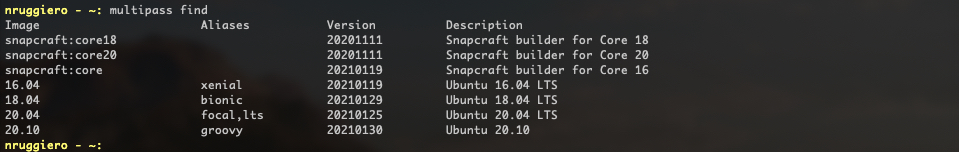
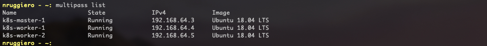
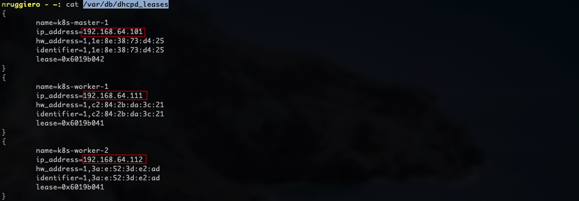
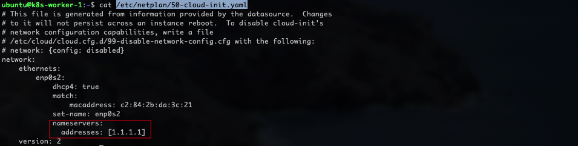
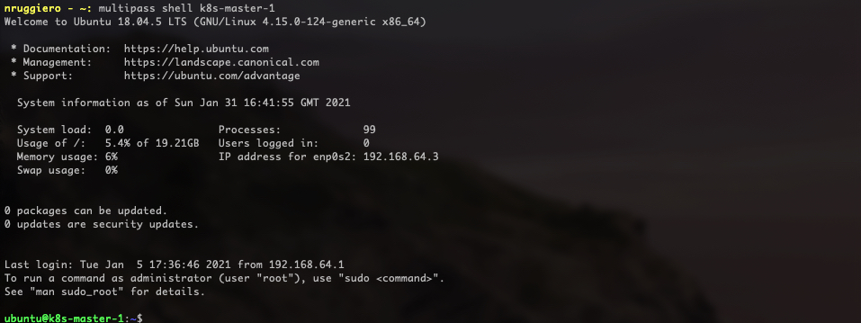
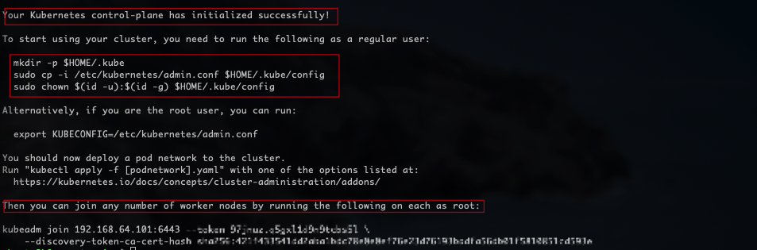
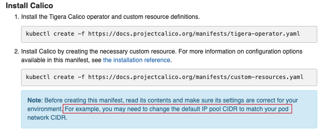
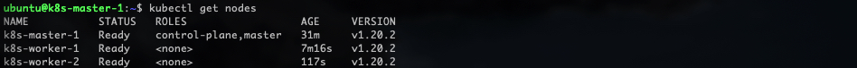
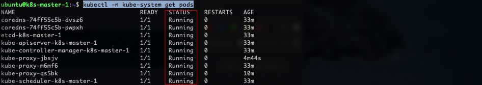

In this short article I will explain how to create a 3 nodes Kubernetes cluster on your Mac leveraging [Multipass](https://multipass.run/).
> "Multipass provides a command line interface to launch, manage and generally fiddle about with instances of Linux. The downloading of a minty-fresh image takes a matter of seconds, and within minutes a VM can be up and running."\
<i>The Register</i>

## Deploying the 3 Kubernetes nodes via Multipass
Let's list what images are available to deploy:
```
multipass find
```


For my Kubernetes Cluster I'll deploy 3 nodes (One master node and two workers) using `Ubuntu 18.04 LTS` as follows:

- name: **k8s-master-1**
- CPU: 2
- Disk: 32 Gb
- Memory: 2 Gb
- image: 18.04

```
multipass launch -c 2 -d 32G -m 2G -n k8s-master-1 18.04
```

- name: **k8s-worker-1**
- CPU: 2
- Disk: 32 Gb
- Memory: 2 Gb
- image: 18.04

```
multipass launch -c 2 -d 32G -m 2G -n k8s-worker-1 18.04
```

- name: **k8s-worker-2**
- CPU: 2
- Disk: 32 Gb
- Memory: 2 Gb
- image: 18.04

```
multipass launch -c 2 -d 32G -m 2G -n k8s-controller-2 18.04
```

A `multipass list` will reveal whether the 3 instances have been deployed and what's their state:


### Multipass tweaks
If you run Multipass on a Mac, the default virtualization engine in use is `hyperkit`. You can verify this setting with the following command:
```
sudo multipass get local.driver
```
If you decide to use [VirtualBox](https://www.virtualbox.org/) for example, you'll need to change the above setting like so:
```
sudo multipass set local.driver=virtualbox
```
Hyperkit provides a preconfigured fixed network for your VMs (`192.168.64.0/24`) and assigns IPs and DNS using the integrated network framework.
Two problems I faced with this approach are:
- You can't assign IP addresses of your choice
- Many VPN, Firewall and Security softwares are [known to interfere](https://multipass.run/docs/troubleshooting-networking-on-macos) with the default DNS server 127.0.0.53 assigned to the VMs, preventing them to connect to the Internet.

For the first problem, the solution I found is to create DHCP reservations, manually editing the file `/var/db/dhcpd_leases`:


> Remember to stop all the running instances (`multipass stop --all`) and restart the multipass daemon (`sudo launchctl stop com.canonical.multipass`) in order for the changes to take effect!

For the second problem, in my case the culprit was the Cisco Umbrella Roaming client installed on my Company's laptop, so I decided to configure a custom DNS server (`1.1.1.1`) by editing the file `/etc/netplan/50-cloud-init.yaml`:


From now on, to access these server's shells, we will use the command
```
multipass shell <instance_name>
```


## Installing the CRI
In order to run Containers we need a [Container Runtime](https://kubernetes.io/docs/setup/production-environment/container-runtimes/). For this excercise we'll use [Docker](https://www.docker.com/).

On each of your nodes, install Docker CE.

```bash
# (Install Docker CE)
## Set up the repository:
### Install packages to allow apt to use a repository over HTTPS
sudo apt-get update && sudo apt-get install -y apt-transport-https ca-certificates curl software-properties-common gnupg2

# Add Docker's official GPG key:
curl -fsSL https://download.docker.com/linux/ubuntu/gpg | sudo apt-key --keyring /etc/apt/trusted.gpg.d/docker.gpg add -

# Add the Docker apt repository:
sudo add-apt-repository "deb [arch=amd64] https://download.docker.com/linux/ubuntu $(lsb_release -cs) stable"

# Install Docker CE
sudo apt-get update && sudo apt-get install -y containerd.io=1.2.13-2 docker-ce=5:19.03.11~3-0~ubuntu-$(lsb_release -cs) docker-ce-cli=5:19.03.11~3-0~ubuntu-$(lsb_release -cs)

## Create /etc/docker
sudo mkdir /etc/docker

# Set up the Docker daemon
cat <<EOF | sudo tee /etc/docker/daemon.json
{
  "exec-opts": ["native.cgroupdriver=systemd"],
  "log-driver": "json-file",
  "log-opts": {
    "max-size": "100m"
  },
  "storage-driver": "overlay2"
}
EOF

# Create /etc/systemd/system/docker.service.d
sudo mkdir -p /etc/systemd/system/docker.service.d

# Restart Docker
sudo systemctl daemon-reload
sudo systemctl restart docker
```

If you want the docker service to start on boot, run the following command:
```bash
sudo systemctl enable docker
```

_From: [Kubernetes Official Documentation](https://kubernetes.io/docs/setup/production-environment/container-runtimes/)_

## Bootstrapping the cluster with kubeadm
### Installing kubeadm, kubelet and kubectl
#### Prerequisites
Make sure that the `br_netfilter` module is loaded. This can be done by running `lsmod | grep br_netfilter`. To load it explicitly call `sudo modprobe br_netfilter`.

As a requirement for iptables to correctly see bridged traffic, you should ensure `net.bridge.bridge-nf-call-iptables` is set to 1 in your `sysctl` config, e.g.

```bash
cat <<EOF | sudo tee /etc/modules-load.d/k8s.conf
br_netfilter
EOF

cat <<EOF | sudo tee /etc/sysctl.d/k8s.conf
net.bridge.bridge-nf-call-ip6tables = 1
net.bridge.bridge-nf-call-iptables = 1
EOF
sudo sysctl --system
```

#### Packages installation
You will install these packages on all of your machines:
- `kubeadm`: the command to bootstrap the cluster.
- `kubelet`: the component that runs on all of the machines in your cluster and does things like starting pods and containers.
- `kubectl`: the command line util to talk to your cluster.

Copy/paste one line at a time (except for the `cat` command. In this case copy from `cat` to `EOF`). Press enter after pasting:
```bash
sudo apt-get update && sudo apt-get install -y apt-transport-https curl
curl -s https://packages.cloud.google.com/apt/doc/apt-key.gpg | sudo apt-key add -
cat <<EOF | sudo tee /etc/apt/sources.list.d/kubernetes.list
deb https://apt.kubernetes.io/ kubernetes-xenial main
EOF
sudo apt-get update && sudo apt-get install -y kubelet kubeadm kubectl

# To avoid Kubernetes packages to be automatically upgraded from any system upgrade
sudo apt-mark hold kubelet kubeadm kubectl
```

### Creating the cluster
This is a three step process:
1. Initialising the cluster with `kubeadm init` on the master nodes
1. Installing a Pod network add-on (**CNI**)
1. Joining the worker nodes to the Cluster

#### Step 1 - Initialising the Cluster
Before proceeding, we'll have to consider what CNI plugin we are going to deploy because such decision might influence the `pod-network-cidr` parameter we'll pass to kubeadm to create the cluster.
For this exercise, for example, we will make use of [Calico](https://www.projectcalico.org/) as our CNI and according to its [documentation](https://docs.projectcalico.org/getting-started/kubernetes/quickstart) the default pod network is `192.168.0.0/16` which conflicts with our nodes network `192.168.64.0/24`,so in this case, I'll go for `172.22.0.0/16`. Only the master node:
```bash
sudo kubeadm init --pod-network-cidr=172.22.0.0/16
```


Don't forget to do the following, as a regular user:
```bash
mkdir -p $HOME/.kube
sudo cp -i /etc/kubernetes/admin.conf $HOME/.kube/config
sudo chown $(id -u):$(id -g) $HOME/.kube/config
```

#### Step 2 - Installing a Pod network add-on
We will follow the instructions from the CNI provider, [here](https://docs.projectcalico.org/getting-started/kubernetes/quickstart).
Pay particular attention, because before creating the CNI pod, we'll need to configure the correct network, as per Step 1.

So for Step 2, instead of `kubectl create -f https://docs.projectcalico.org/manifests/custom-resources.yaml` we'll download the yaml file and edit according to our needs, before creating the resource:
```bash
wget https://docs.projectcalico.org/manifests/custom-resources.yaml
sed -i 's/cidr\: 192.168.0.0\/16/cidr\: 172.22.0.0\/16/g' custom-resources.yaml
kubectl create -f custom-resources.yaml
```
Confirm that all of the pods are running with the following command:
```bash
watch kubectl get pods -n calico-system
```
Wait until each pod has the `STATUS` of `Running`.

#### Step 3 - Joining the worker nodes to the Cluster
On the 2 worker nodes, run the command produced from the `kubeadm init` output:

```bash
kubeadm join 192.168.64.101:6443 --token <token> \
    --discovery-token-ca-cert-hash sha256:<discovery-token-ca-cert-hash>
```

If you forgot to take note of the token, or your token has expired (24-hour TTL), you can generate a new token with the following command:

```bash
$ kubeadm token create --print-join-command
```
and use the output to join the worker node.

If you followed the instructions carefully you should now have a shiny new 3 nodes Kubernetes cluster and the status of the 3 nodes should be `Ready`. Try:
```bash
kubectl get nodes
```


Additionally, check the status of the pods in the `kube-system` namespace:
```bash
kubectl -n kube-system get pods`
```

