In this article we'll setup a 3 nodes Kubernetes Cluster running on 3 Raspberry Pi 4B boards.
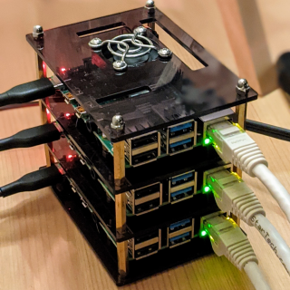
I chose the 4 MB model but according to Kubernetes minimum requirements, 2 MB or RAM should be enough.

If You are interested in building your own Cluster, here is the list of components I used:
- 3X [Raspberry Pi 4 Modell B 4GB](https://www.amazon.co.uk/gp/product/B07TC2BK1X/ref=ppx_yo_dt_b_asin_title_o05_s02?ie=UTF8&psc=1)
- 3X [Kingston microSD Card 32 GB](https://www.amazon.co.uk/gp/product/B07YGZ7FY7/ref=ppx_yo_dt_b_asin_title_o05_s01?ie=UTF8&psc=1)
- 3X [0.5 m Cat6 Patch Short Ethernet Cable](https://www.amazon.co.uk/gp/product/B01MTF7QL8/ref=ppx_yo_dt_b_asin_title_o05_s00?ie=UTF8&psc=1)
- 1X [Anker PowerLine USB C to USB 3.0 Cable, 3 Pack](https://www.amazon.co.uk/gp/product/B01HF0YGCK/ref=ppx_yo_dt_b_asin_title_o05_s02?ie=UTF8&psc=1)
- 1X [Pi Rack Case for Raspberry Pi](https://www.amazon.co.uk/gp/product/B07J9VMNBL/ref=ppx_yo_dt_b_asin_title_o05_s00?ie=UTF8&psc=1)
- 1X [USB Charger RAVPower 60W 12A](https://www.amazon.co.uk/gp/product/B07MFPN87Y/ref=ppx_yo_dt_b_asin_title_o05_s02?ie=UTF8&psc=1)


## Step 1 - Creating the MicroSD
From https://www.raspberrypi.org/software/ download Raspberry Pi Imager

1. Plug the MicroSD Card into you computer and launch Raspberry Pi Imager:
   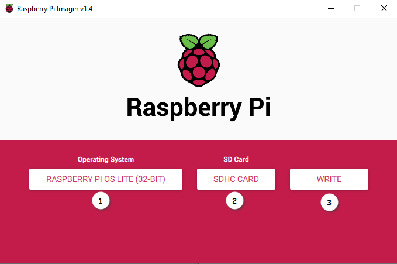
   1. Select the OS "Raspberry Pi OS Lite" because it has no GUI
   1. Select your MicroSD Card
   1. Write the OS onto the MicroSD

### Enabling ssh
Since your Raspberry Pis don't have a GUI, we'll manage them over SSH. In order to do that, we'll have to create a `ssh` file in the `/boot` partition.
1. In Windows explorer, select the letter assiciated to your MicroSD, In my case `D:`
   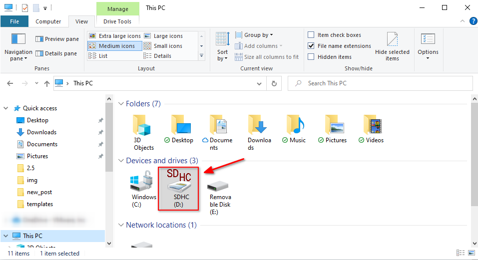
1. Inside the folder, create a new empty txt file. Name it ssh, without extension.
   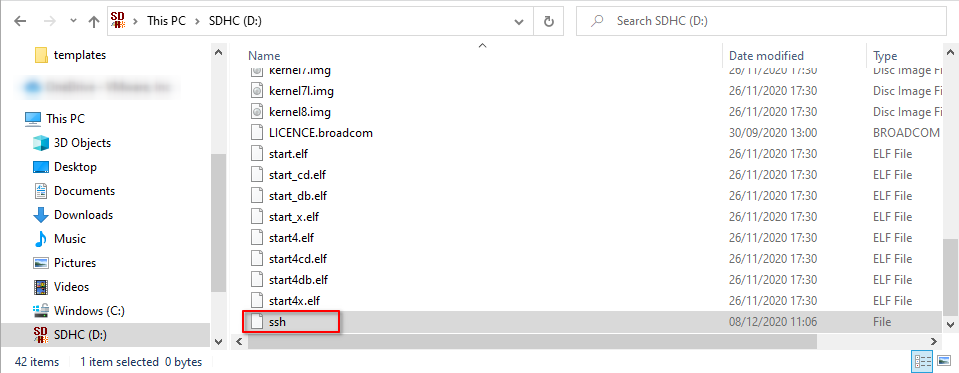
   This will instruct the Raspberry OS to enable and start the ssh service at boot.
   
## Step 2 - Booting the Pis and setting hostname and IP
1. From your home router DHCP devices list, you should  be able to see you Raspberry Pi IP
   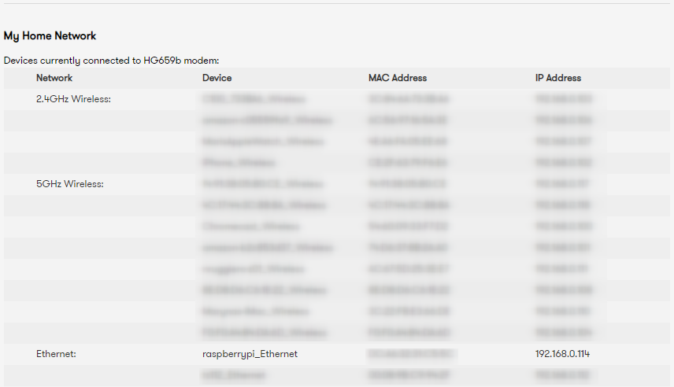
   in my case, the name is `raspberrypi_Ethernet` and the ip `192.168.0.114`.
1. Now SSH into you Pi and set the hostname. The default username is `pi` and default password is `raspberry`:
   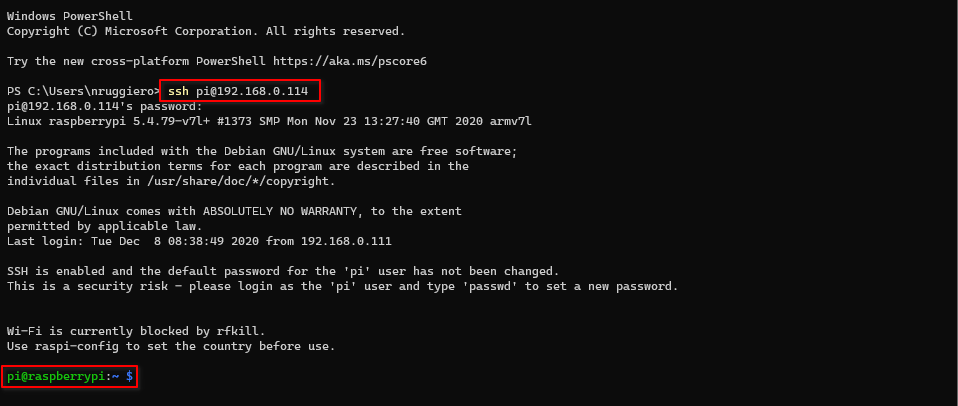
   Using an editor of your choice edit `/etc/hostname` and `/etc/hosts` with your choosen name:
   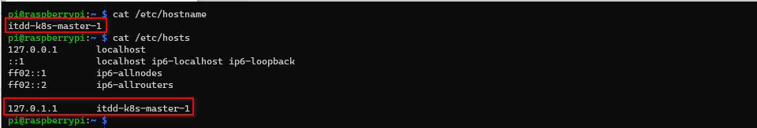
   You could also use sed to replace the original hostname with the new one:
   ```
   $ sudo sed -i 's/raspberrypi/itdd-k8s-worker-2/' /etc/hosts /etc/hostname
   ```
1. [Optional] In my case I've also decided to create a DCHP reservation, so that I'll always know what IP assigned to what device:
   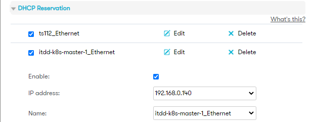
1. Proceed in the same way for the remaining nodes. in my case I'll setup 3 nodes:
   - itdd-k8s-master-1,	IP 192.168.0.140
   - itdd-k8s-worker-1,	IP 192.168.0.151
   - itdd-k8s-worker-2,	IP 192.168.0.152
1. If everything worked fine, you should have your k8s nodes up and running:
   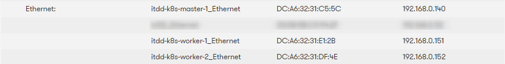
   
## Step 3 - Software installation
The following commands have to be exected on all the nodes

### Updating the OS
1. Upgrade the system:
   ```
   sudo apt update && sudo apt upgrade -y
   ```
1. Add the following options to `/boot/cmndline.txt`:
   ```
   cgroup_enable=cpuset cgroup_memory=1 cgroup_enable=memory
   ```
   So that the file should look like this:
   ```
   $ cat /boot/cmdline.txt
   console=serial0,115200 console=tty1 root=PARTUUID=f8890bb1-02 rootfstype=ext4 elevator=deadline fsck.repair=yes rootwait cgroup_enable=cpuset cgroup_memory=1 cgroup_enable=memory
   ```
1. Uninstall and disable swap:
   ```
   $ sudo dphys-swapfile swapoff
   $ sudo dphys-swapfile uninstall
   $ sudo apt purge -y dphys-swapfile
   ```
1. Reboot the nodes:
   ```
   $ sudo reboot
   ```
### Docker installation
1. Install Docker and add your user to the docker group
   ```
   $ curl -sSL get.docker.com | sh
   $ sudo usermod -aG docker pi
   ```
1. Logout and log back in
1. As the root user create the file `/etc/docker/daemon.json` with the following content:
   ```json
   {
   "exec-opts": ["native.cgroupdriver=systemd"],
   "log-driver": "json-file",
   "log-opts": { "max-size": "100m" },
   "storage-driver": "overlay2"
   }
   ```

   ```bash
   $ sudo su -
   $ cat << EOF > /etc/docker/daemon.json
   {
   "exec-opts": ["native.cgroupdriver=systemd"],
   "log-driver": "json-file",
   "log-opts": { "max-size": "100m" },
   "storage-driver": "overlay2"
   }
   EOF
   $ exit
   ```
1. Create a directory for the control files:
   ```
   $ sudo mkdir -p /etc/systemd/system/docker.service.d
   ```

### Kubernets installation
1. First, import the GPG key, like we did for the Docker repository:
   `$ curl -s https://packages.cloud.google.com/apt/doc/apt-key.gpg | sudo apt-key add -`
1. Add kubernetes repositiry:
   ```
   $ sudo vim /etc/apt/sources.list.d/kubernetes.list
   ```
   And add the following line to the file:
   ```
   deb http://apt.kubernetes.io/ kubernetes-xenial main
   ```
1. Install required Kubernetes packages
   ```
   $ sudo apt update
   $ sudo apt install -y kubeadm kubectl kubelet
   ```

## Step 4 - Configuring k8s Cluster
### Initialize the k8s Cluster
Only on the Master node:
1. Initialize the Cluster
   ```
   sudo kubeadm init --pod-network-cidr=10.244.0.0/16
   ```
   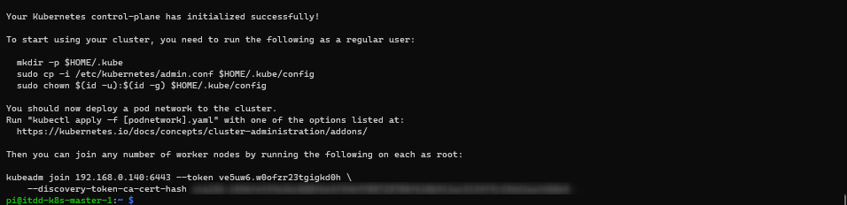
1. run the following as a regular user:
   ```
   mkdir -p $HOME/.kube
   sudo cp -i /etc/kubernetes/admin.conf $HOME/.kube/config
   sudo chown $(id -u):$(id -g) $HOME/.kube/config
   ```
### Deploy flannel as the CNI
In order to provide networking capabilities among the nodes, we need to deploy a Container Network Interface ([CNI](https://kubernetes.io/docs/concepts/cluster-administration/networking/)). There are many different options to choose from. For this instance, we are going to use one of the most common: [Flannel](https://github.com/coreos/flannel#flannel) 
   ```
   kubectl apply -f https://raw.githubusercontent.com/coreos/flannel/master/Documentation/kube-flannel.yml
   ```
### Validate the Cluster functionality
1. Validate all pods in the kube-system namespace are up and running:
   `kubectl get pod --all-namespaces` or `kubectl get pod -n kube-system`:
   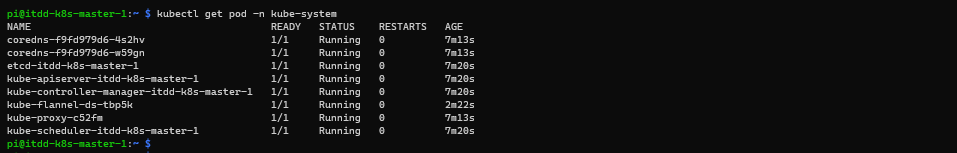
   
### Join the Worker Nodes to the Master 
Recall the join command generated from the kubeadm init command and run it on each and every node as sudo:
   
   
### Verify the installation from the master node
You can run kubectl get nodes to get a list of the nodes and their status:
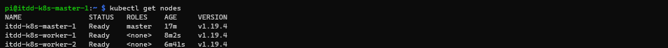

You can also add -o wide to the command to get more information:
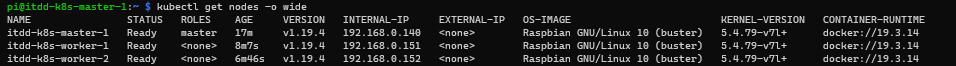

You can also query the status of the kube-system pods as following:
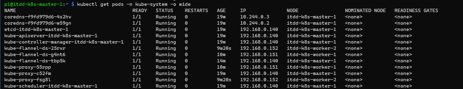

And that concludes this article on how to install and configure a 3 nodes Kubernetes Cluster on Raspberry Pi.