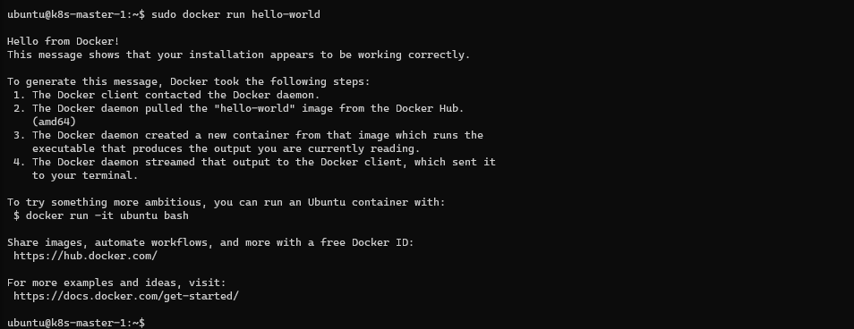

In the [first part](../homelab-k8s-ubuntu-multipass) we discussed how to deploy **Ubuntu Server 20.04** on Hyper-V using Multipass. in this article we'll install Docker and provide some basic commands.

## Docker installation
From [Docker Docs](https://docs.docker.com/engine/install/ubuntu/)

### Prerequisites

1. Update the current installation:
   ```
   sudo apt update && sudo apt upgrade -y
   ```

2. Install the required tools:
   ```
   sudo apt-get install apt-transport-https ca-certificates curl gnupg2 software-properties-common
   ```

### Install Docker CE
1. Import the gpg key
   ```
   $ curl -fsSL https://download.docker.com/linux/ubuntu/gpg | sudo apt-key add -
   ```
1. Add docker repo for Ubuntu 20.04
   ```
   $ sudo add-apt-repository "deb [arch=amd64] https://download.docker.com/linux/ubuntu $(lsb_release -cs) stable"
   ```
1. Update apt and install the Docker Engine
   ```
   $ sudo apt update && sudo apt install docker-ce docker-ce-cli containerd.io
   ```
1. Add the current user to the docker group (to avoid prepending *sudo* to docker commands)
   ```
   $ sudo usermod -aG docker $USER
   ```
1. Testing if Docker is running properly
   ```
   $ sudo docker run hello-world
   ```
   

### Container Registries

#### Creating an Insecure Docker Registry


### Useful Docker commands
Command |
-|-
`docker pull <image>` | Download an image
`docker run <image>` | Download and run the image
`docker images` | List all downloaded images
`docker run -it <image>` | Run an image an allocate a TTY
`docker run -d <image>` | Run container in background and print container ID
`docker ps` | List containers
`docker start <id>` | Start one or more stopped containers
`docker stop <id>` | Stop one or more running containers
`docker rm <id>` | Remove one or more containers
`docker system prune` | Remove unused data

## Next steps
- Check out [Getting started with Containers](../getting-started-with-containers)


sudo docker run --detach --restart=always --name registry --publish 5000:5000 --volume /srv/registry:/var/lib/registry registry:2

docker tag sample-container:v1.0 k8s-master-1:5000/sample-container:v1.0

docker push k8s-master-1:5000/sample-container:v1.0

{
"insecure-registries" : [ "k8s-master-1:5000", "k8s-master-1.mshome.net:5000"]
}

sudo apt-get update && sudo apt-get install -y apt-transport-https curl
curl -s https://packages.cloud.google.com/apt/doc/apt-key.gpg | sudo apt-key add -
cat <<EOF | sudo tee /etc/apt/sources.list.d/kubernetes.list
deb https://apt.kubernetes.io/ kubernetes-xenial main
EOF
sudo apt-get update
sudo apt-get install -y kubelet kubeadm kubectl
sudo apt-mark hold kubelet kubeadm kubectl


mkdir -p $HOME/.kube
sudo cp -i /etc/kubernetes/admin.conf $HOME/.kube/config
sudo chown $(id -u):$(id -g) $HOME/.kube/config

kubectl apply -f https://raw.githubusercontent.com/coreos/flannel/master/Documentation/kube-flannel.yml

Your Kubernetes control-plane has initialized successfully!

To start using your cluster, you need to run the following as a regular user:

  mkdir -p $HOME/.kube
  sudo cp -i /etc/kubernetes/admin.conf $HOME/.kube/config
  sudo chown $(id -u):$(id -g) $HOME/.kube/config

You should now deploy a pod network to the cluster.
Run "kubectl apply -f [podnetwork].yaml" with one of the options listed at:
  https://kubernetes.io/docs/concepts/cluster-administration/addons/

Then you can join any number of worker nodes by running the following on each as root:

kubeadm join 172.28.161.147:6443 --token cnkcar.n2dstqeeah5c1v2y \
    --discovery-token-ca-cert-hash sha256:48a834a417900861d53294cbf6bb8db569650c6f7caa29ef844579a32a9869d3
